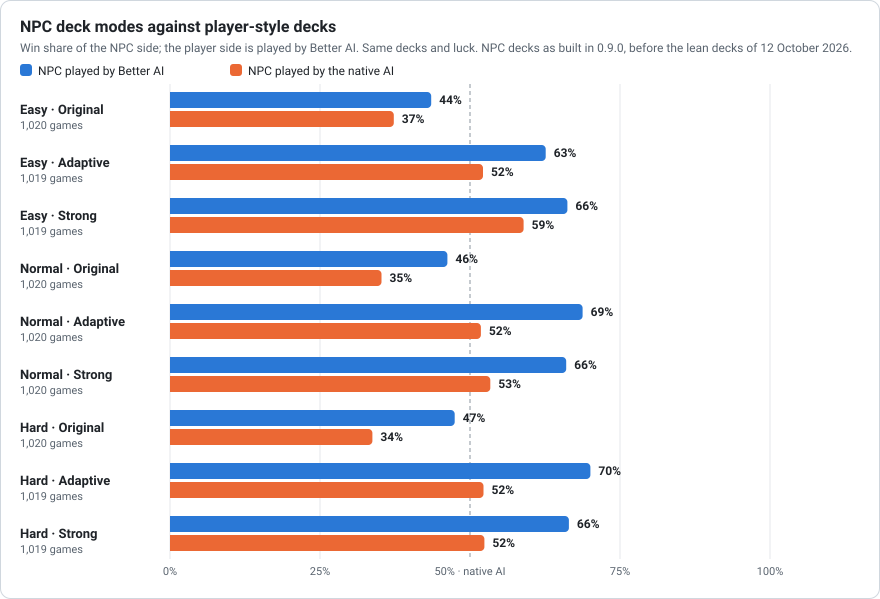
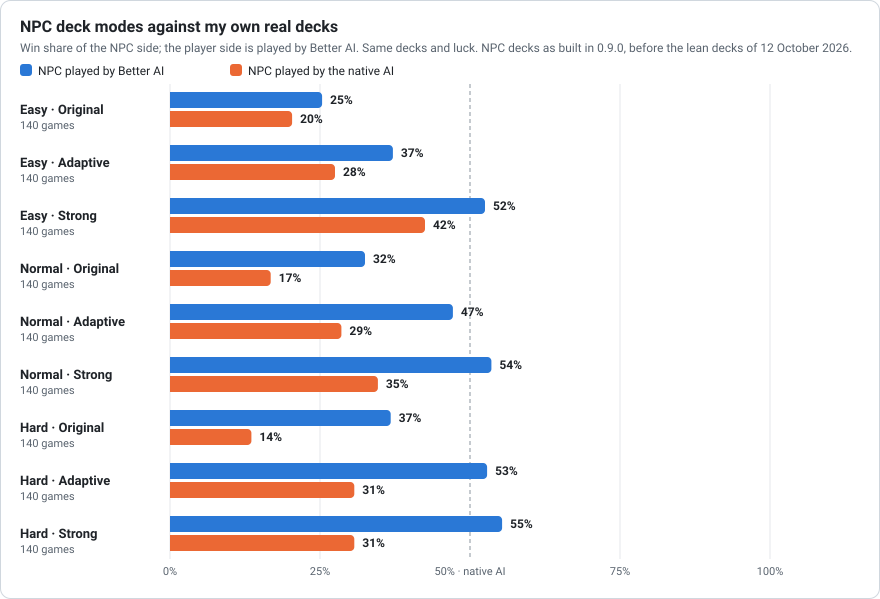
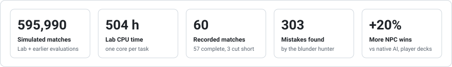
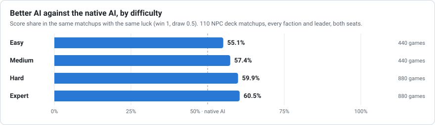
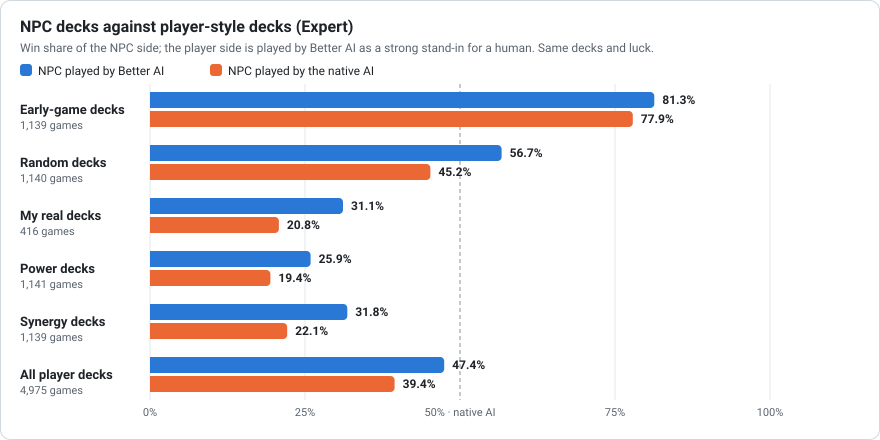
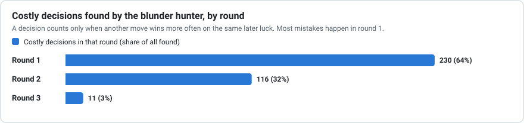
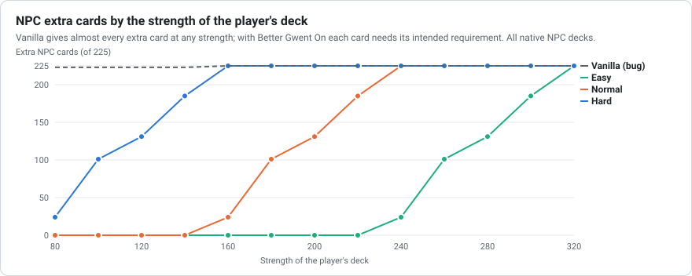
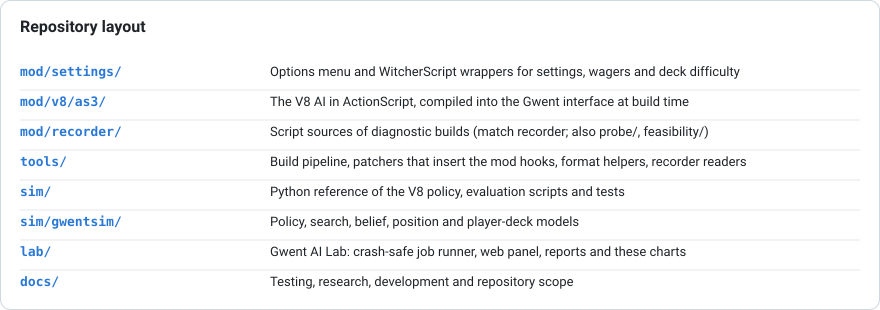

# Better Gwent AI

An unofficial mod for The Witcher 3: Wild Hunt (**Steam patch 5.01**)
that replaces the Gwent opponent's decisions with a stronger AI, without changing any card,
ability or rule. NPC decks stay exactly as in the game unless you choose otherwise, and
everything returns to vanilla when the mod is turned Off.

> **Not magic, not a miracle.** The AI can still make mistakes. Better Gwent AI only
> improves how it decides, through math, search and a lot of testing.

This is an unofficial fan work and is not approved or endorsed by CD PROJEKT RED.
**Status: 0.9.0 beta.** Installation: [docs/INSTALL.md](docs/INSTALL.md).

## Features

- **Options > Mods > Better Gwent AI**, with an On/Off switch (Off = vanilla game).
- Easy, Normal and **Hard (default)**, independent of the game difficulty.
- Optional **AI plays for you** (Off by default), using the selected difficulty.
- Common Gwent wager maximum: Vanilla (10), 25, 50, 100 or 150 (money only).
- Optional stronger existing NPC deck variants at higher stakes (Off by default).
- Menu in 18 languages.
- **Better AI Off = the original game**, wagers included; the wager options are locked
  while it is Off.
- **NPC decks: Original (default) / Adaptive / Strong**: which existing cards an NPC brings,
  rebuilt in memory for each match, safe for saves. Adaptive is checked in game; Strong is
  checked in the simulator.
- **The NPC exchanges up to two opening cards** (Normal and Hard), as you can, and first the
  weather card its leader can pull from the deck. Lab: +5.4 points of NPC win share with
  Adaptive decks even when the player exchanges too
  (z 3.9).

## NPC decks: Original, Adaptive, Strong

Native NPC decks are uneven: many carry piles of weather and special cards (about 10 special
cards on average, up to 13 weather cards), and the vanilla game gives them extra cards
regardless of your deck because of an inverted check. This option chooses what the NPC brings:

- **Original:** the NPC's own deck with the game's own adaptive rule, repaired. Each NPC has
  a few extra cards on 15 levels that enter only when your deck is strong enough; with the
  inverted check fixed, they finally follow your deck. But it is a small lever: 4.4 extra
  cards per NPC on average (14 of 51 NPCs have none), worth about +31 strength (173 to 205),
  while a good player deck sits at 250-300, and the pile of weather cards stays in.
- **Adaptive:** the same idea done fully. The NPC keeps its faction, leader and heroes; its
  whole deck is made legal and playable, and its weakest units are swapped for better cards
  of its faction until it matches the strength of *your* deck at that match: 85% on Easy,
  100% on Normal, 110% on Hard. A fair fight at every stage of the game.
- **Strong:** the best deck the NPC's faction allows under the same rules.

Every deck is built like a seasoned player builds one: a playable kit of special cards
(never more than 8), no weather that hits its own strong rows, synergies kept whole, spies and
medics capped, and leader-aware choices (a leader that clears weather replaces the Clear Weather
card; a leader that doubles a row leaves one Horn for the other rows). It applies to every
Gwent opponent, including quest and tournament players, except the tutorial.

Measured in the simulator (same decks and luck; the player side is played by Better AI):

<picture>
  <source media="(prefers-color-scheme: dark)" srcset="docs/img/deck-modes-dark.svg">
  
</picture>

<picture>
  <source media="(prefers-color-scheme: dark)" srcset="docs/img/deck-modes-mine-dark.svg">
  
</picture>

Against my own real decks (140 games per cell), Adaptive goes from 37% on Easy to 53% on
Hard, an even fight, and Strong stays hard but winnable at 52-55% on every level.

Nothing is written to your save and no card is edited: the NPC's deck is rebuilt in memory
for that match only. Turn the option or the mod Off and the next match uses the native deck.
Details: [docs/NPC_DECKS.md](docs/NPC_DECKS.md).

### Choosing your challenge

<picture>
  <source media="(prefers-color-scheme: dark)" srcset="docs/img/challenge-dark.svg">
  
</picture>

<details>
<summary>Details</summary>

You set the challenge with two independent dials:

1. **AI difficulty (Easy, Normal, Hard): how well the NPC thinks.** It sets how deeply the AI
   analyses its moves; on Hard it thinks longest and makes the fewest mistakes.
2. **NPC decks (Original, Adaptive, Strong): which cards the NPC plays.**
   - **Original:** the game's deck, with the extra-card rule repaired. The NPC only gets the few
     extra cards the game lists for it (4.4 on average, none for 14 of 51 NPCs), so against a
     strong deck it stays weaker.
   - **Adaptive:** the NPC gets more and better cards than in Original, but balanced: its deck
     is rebuilt to follow the strength of yours, and the difficulty sets the target, from 85%
     of your deck's strength on Easy to 110% on Hard.
   - **Strong:** the best deck the NPC's faction allows.

Two wager options come with it, both part of Better AI: a higher maximum bet for common Gwent
matches (money only, the NPC is not harder), and an optional setting that makes NPCs stronger
the more gold you bet. Turning **Better AI Off turns everything off**: the native AI, the game's
own decks and the vanilla wagers, with no exception. Your choices are kept for when you turn it
back On.

Combinations, from light to heavy:

- **The original game:** mod Off.
- **Just a smarter opponent:** Hard with Original decks.
- **A fair fight all game long:** Normal or Hard with Adaptive decks.
- **Maximum challenge:** Hard with Strong decks and stronger stakes On. Against my own real
  decks the NPC wins about half of the matches (55% on Hard): very hard, still winnable.

</details>

## Fair play: the AI does not see your cards

The AI plays harder by reasoning better, not by cheating. It only uses what a human
player could see: the board, both graveyards, how many cards you hold, your faction and
leader, the cards you have already played and cards revealed by an effect. It never
reads your hand, your deck list or the order of your draws. It samples plausible hidden
hands from public information instead, and an automated test swaps the hidden hand for
different cards and checks that the decision does not change. Its opening exchange uses only
its own hand and which of its own cards are left in its deck, never their order.

## Status

- The V8 decision engine (ActionScript, `mod/v8/as3`) runs inside the game and plays
  whole matches; on errors or time-outs it falls back to the native AI, so a match
  never stalls.
<picture>
  <source media="(prefers-color-scheme: dark)" srcset="docs/img/kpis-dark.svg">
  
</picture>

<picture>
  <source media="(prefers-color-scheme: dark)" srcset="docs/img/levels-dark.svg">
  
</picture>

<picture>
  <source media="(prefers-color-scheme: dark)" srcset="docs/img/player-decks-dark.svg">
  
</picture>

<picture>
  <source media="(prefers-color-scheme: dark)" srcset="docs/img/mistakes-dark.svg">
  
</picture>

- In progress: fixing the mistake patterns the hunter found (round-1 overcommit, Horn and
  weather timing, Spy value), then self-play parameter tuning and a small value network.
- How the AI is measured and the full numbers: [docs/TESTING.md](docs/TESTING.md). The
  charts are generated from the Lab results with `lab/dashboard.py`.

## NPC deck strength: a vanilla bug we fix

Each NPC deck has dynamic extra cards on 15 levels, and each level has a requirement
compared against the strength of the player's deck: the extra card enters only when the
player's deck is strong enough. The NPC deck was meant to grow with the player's.

The vanilla `GetDifficulty` function has its size check inverted: it only returns a real
requirement for **level 15**, and **levels 1–14 always return 0**. So every extra card of
levels 1–14 always enters the NPC deck, even against a weak early-game player deck.

**With Better Gwent AI On, the intended rule applies at every level and every difficulty**:
each extra card uses its real requirement (base 145–230 by level; +80 on Easy, −80 on
Hard). The highest optional stronger-stakes stage still gives every extra
card. With the mod Off the game is untouched. No card or deck definition is added,
removed or edited.

<picture>
  <source media="(prefers-color-scheme: dark)" srcset="docs/img/requirements-dark.svg">
  
</picture>

Our own recorded player decks measured 214–284, so Hard NPCs keep every extra card against a
normal deck; the fix mainly makes the early game and Easy/Normal fair.

## Research behind it

The AI samples plausible hidden hands and searches its moves and the opponent's replies
(Information Set Monte Carlo Tree Search; Perfect Information Monte Carlo sampling).
Tests compare options on the same luck, as duplicate poker does, and the deep blunder hunt
narrows every legal move with Sequential Halving (as in Gumbel MuZero). Next: parameter
tuning by self-play (SPSA) and a small value network (AlphaZero). Papers, tools and what I
tried and dropped: [docs/RESEARCH.md](docs/RESEARCH.md).

## Repository layout

<picture>
  <source media="(prefers-color-scheme: dark)" srcset="docs/img/layout-dark.svg">
  
</picture>

## Development (local setup)

Prerequisites: Python 3, `pytest`, `psutil` (Lab), Java + FFDec at `tools/ffdec`, and a
Witcher 3 5.01 installation. Details in [docs/DEVELOPMENT.md](docs/DEVELOPMENT.md);
PyPy is installed separately (`uv python install pypy3.11`) and is not part of the repository.

```sh
python3 tools/build_settings.py                     # menu labels -> *.w3strings
python3 tools/build_npc_decks.py                    # NPC deck table (needs the local vanilla XML)
python3 tools/build_v8_core.py                      # compile V8 into the Gwent interface
python3 tools/build_v8_package.py release           # -> dist/BetterGwentAI-<version>.zip
python3 tools/build_v8_core.py --with-recorder      # same, plus the match recorder
python3 tools/build_v8_package.py recorder          # -> dist/BetterGwentAI-<version>-recorder.zip
python3 -m pytest sim/tests -q                      # test suite
```

Back up the game files and saves before installing a test build.

### Gwent AI Lab

Runs long benchmarks and blunder hunts in the background, with progress, CPU/GPU/RAM
and disk usage in a browser panel (`http://127.0.0.1:8765`, local only).

```sh
python3 lab/gwent_lab.py            # PC: starts paused, press Resume
python3 lab/gwent_lab.py --no-open  # headless server (reach it through an SSH tunnel)
GWENT_LAB_SERVER=user@host lab/open_server_panel.sh
```

- Data lives in a folder marked with `.gwent_ai_lab_root` (default `/mnt/hdd/GwentAILab`,
  `--data` or `GWENT_LAB_DATA` to change); the Lab refuses to start without the marker.
- Crash-safe: results are committed together with the task state, so a power cut only
  repeats the tasks that were running (`lab/selftest_resume.py` verifies this).
- Workers run at low priority, their number is adjustable live, and they pause while
  `witcher3.exe` runs or when the disk cap is reached.
- Continuous jobs queue the next seed by themselves when they finish.
- Workers can run under PyPy (setting `worker_python`, e.g. from `uv python install pypy3.11`):
  1.7x faster on benchmarks and 2.1x on blunder hunts with identical results, so fewer
  workers (less heat) produce the same output. Changing the setting swaps workers live.

## Documentation

- [Installation](docs/INSTALL.md): install, options, compatibility and uninstall.
- [Recorder edition](docs/RECORDER.md): record your matches to help development.
- [NPC decks](docs/NPC_DECKS.md): the Original / Adaptive / Strong option.
- [Testing](docs/TESTING.md): methods, results and running totals.
- [Research](docs/RESEARCH.md): papers, tools, and what I tried and dropped.
- [Development](docs/DEVELOPMENT.md): local setup, builds, tests and the Lab.
- [Repository scope](docs/PUBLICATION_SCOPE.md): what may and may not be committed.

Detailed research notes and the working log are kept locally, outside the repository.

## AI disclosure

Transparency matters here: this project is built with AI assistants used as tools
throughout development and maintenance.

In practice the AI takes the repetitive, low-level work: writing code for a direction
that is already decided, running and reading simulations, building validation scripts,
tracking down the exact point of a bug, and drafting and updating documentation. Scope,
design and gameplay decisions are mine, every change is measured in the simulator and
tested in game before it is kept, and nothing is merged or released without my review,
including code the AI wrote entirely.

## Credits

- [JPEXS Free Flash Decompiler](https://github.com/jindrapetrik/jpexs-decompiler): the open-source
  Flash decompiler and editor used to build the V8 AI into the game's Gwent interface.
- The [WolvenKit](https://github.com/WolvenKit) and W3Edit teams: for pioneering Witcher 3
  reverse engineering and documenting the file formats (CR2W, bundles) that the community
  tools, including this project's own, build on.
- The Witcher 3, Gwent and all their assets belong to CD PROJEKT RED.

## License and rights

Original contributions are covered by [LICENSE](LICENSE) (MIT). The game, game-derived
material, names and trademarks are excluded. See [NOTICE](NOTICE.md).
