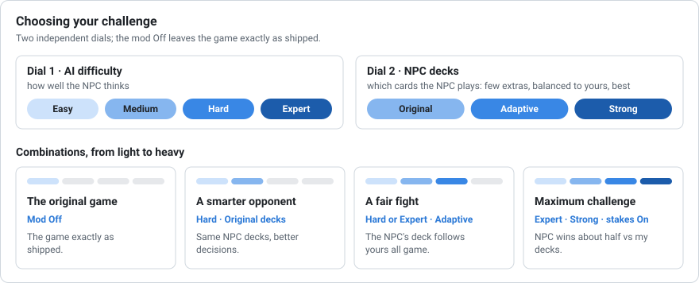

# Features and options in detail

Everything is in **Options > Mods > Better Gwent** (menu in 18 languages). Installation and the
short list of options: [Installation](INSTALL.md).

## Better Gwent Off = the original game

Turning **Better Gwent Off turns everything off**: the native AI, the game's own decks and the
vanilla wagers, with no exception. The wager options are locked while it is Off. Your choices
are kept for when you turn it back On. The mod can be installed or removed at any time.

## The opponent AI

- **Difficulty: Easy, Normal and Hard (default)**, independent of the game difficulty. It sets
  how deeply the AI analyses its moves; on Hard it thinks longest and makes the fewest mistakes.
- **The decision engine** (V8, written in ActionScript, `mod/v8/as3`) runs inside the game and
  plays whole matches. On errors or time-outs it falls back to the native AI, so a match never
  stalls.
- **Opening exchange.** On Normal and Hard the NPC exchanges up to two opening cards, as you can,
  and first the weather card its leader can pull from the deck. In the Lab: +5.4 points of NPC
  win share with Adaptive decks, even when the player exchanges too (z 3.9).
- **AI plays for you** (Off by default): the AI also plays your side with the selected
  difficulty (you still pick your deck and your opening exchange).

How the AI decides and what it is built on: [Research](RESEARCH.md). How it is measured:
[Testing](TESTING.md).

## Fair play: the AI does not see your cards

The AI does not cheat. It gets harder only by reasoning better, and it uses only what a human
player could see: the board, both graveyards, how many cards you hold, your faction and leader,
the cards you have already played and cards revealed by an effect. It never reads your hand, your
deck list or the order of your draws. It samples plausible hidden hands from public information
instead, and an automated test swaps the hidden hand for different cards and checks that the
decision does not change. Its opening exchange uses only its own hand and which of its own cards
are left in its deck, never their order.

## NPC decks: Adaptive (default), Original, Strong

Which existing cards an NPC brings, rebuilt in memory for each match, safe for saves. Adaptive
is checked in game; Strong is checked in the simulator. Full description, rules and tests:
[NPC decks](NPC_DECKS.md).

## Wagers

- **Gwent max bet** for common Gwent matches: Vanilla (10), 25, 50, 100 or 150. Money only: the
  NPC is not harder.
- **Higher stakes, stronger opponent** (Off by default): the more gold you bet, the stronger the
  existing NPC deck variant it uses.

## Choosing your challenge

<picture>
  <source media="(prefers-color-scheme: dark)" srcset="img/challenge-dark.svg">
  
</picture>

You set the challenge with two independent dials:

1. **AI difficulty (Easy, Normal, Hard): how well the NPC thinks.**
2. **NPC decks (Original, Adaptive, Strong): which cards the NPC plays.**
   - **Original:** the game's deck, with the extra-card rule repaired. The NPC only gets the few
     extra cards the game lists for it (4.4 on average, none for 14 of 51 NPCs), so against a
     strong deck it stays weaker.
   - **Adaptive:** the NPC gets more and better cards than in Original, but balanced: its deck
     is rebuilt to follow the strength of yours, and the difficulty sets the target, from 85%
     of your deck's strength on Easy to 110% on Hard.
   - **Strong:** the best deck the NPC's faction allows.

Combinations, from light to heavy:

- **The original game:** mod Off.
- **Just a smarter opponent:** Hard with Original decks.
- **A fair fight all game long:** Normal or Hard with Adaptive decks.
- **Maximum challenge:** Hard with Strong decks and stronger stakes On. Against my own real
  decks the NPC wins about half of the matches (55% on Hard): very hard, still winnable.

## Card art

While the mod is On, the copies of one card show different pictures, from the game's own art.
The change is visual only. Details: [One artwork per card copy](CARD_ART.md).
