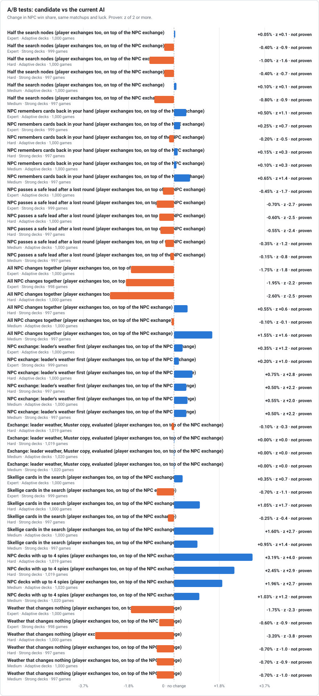
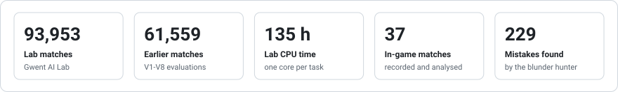

# How Better Gwent AI is tested

The AI is measured in a local simulator that reproduces the game's Gwent rules, then
checked in real matches inside the game.

## 1. Fidelity: does the simulator play like the game?

- In-game matches are recorded with every random draw and decision. The fidelity corpus
  (matches against the native AI) is replayed move by move and must match exactly:
  **22 of 23** do; the remaining one (a Scorch ordering case) is a known open issue and
  is never hidden by the tests. Matches played by Better AI are analysed separately
  (decision notes, timing, errors); the native replay cannot reproduce its decisions.
- NPC decks built by the simulator match the game's decks in every available recording.

## 2. Strength: benchmark against the native AI

Each matchup is played three times with the same deck pair and the same luck (seed):
native AI vs native AI, then Better AI in each seat. The score compares the Better AI
seat against the native AI in the same seat (win = 1, draw = 0.5).

- **Deck pool:** 110 matchups covering every faction and every leader, built from the
  game's own NPC decks; both seats, 440 games per level per seed.
- **Player-style decks:** 490 matchups of NPC decks against decks a player builds
  (power, synergy, random and early-game styles for every faction and leader, plus
  my 10 real decks). The player side is played by Better AI itself as a strong
  stand-in for a human; the NPC side is played by the native AI or by Better AI.

<picture>
  <source media="(prefers-color-scheme: dark)" srcset="img/levels-dark.svg">
  
</picture>

<picture>
  <source media="(prefers-color-scheme: dark)" srcset="img/player-decks-dark.svg">
  
</picture>

### NPC deck modes

<picture>
  <source media="(prefers-color-scheme: dark)" srcset="img/deck-modes-dark.svg">
  
</picture>

<picture>
  <source media="(prefers-color-scheme: dark)" srcset="img/deck-modes-mine-dark.svg">
  
</picture>

## 3. Mistakes: blunder hunting

For matches the AI lost or drew, every decision is replayed with alternative moves. Each
option is compared on the **same** later luck (like duplicate poker), so luck is not
mistaken for a mistake; a decision is reported only when another move is clearly better
on average.

A deeper hunt also covers won matches, every legal move (narrowed with Sequential
Halving, as in Gumbel MuZero) and smaller mistakes. Findings become regression cases.

<picture>
  <source media="(prefers-color-scheme: dark)" srcset="img/mistakes-dark.svg">
  
</picture>

### A/B tests

Every change to the AI is compared with the current AI on the same matchups and luck, and kept
only when the gain is proven (z of 2 or more) and nothing gets worse.

<picture>
  <source media="(prefers-color-scheme: dark)" srcset="img/ab-dark.svg">
  
</picture>

## 4. In-game validation

I test every build in real matches with the mod installed; each match is recorded and
analysed (decision source, timing, errors). Problems I found in game and fixed so far:
stalled matches, wager menu values, wasted Frost/Horn, round-1 overcommit, weaker NPC
decks, Medic choosing a siege unit over a Spy, muster groups split by the Adaptive decks, and
the NPC never exchanging opening cards (now it does, on Normal and Hard), repeated heroes in
the NPC decks, and a 3 s thinking limit that cut Hard's opening searches.

## Running totals

Updated as tests run (`python3 lab/report.py <lab databases> --evaluations <reports>`); the README
charts come from `python3 lab/dashboard.py <lab databases>`.

<picture>
  <source media="(prefers-color-scheme: dark)" srcset="img/totals-dark.svg">
  
</picture>

## Infrastructure

- **Gwent AI Lab** (`lab/`): crash-safe job runner; a power cut only repeats the tasks
  that were running, and a self-test kills workers repeatedly and requires identical results.
- Workers run under **PyPy** (1.7–2.1x faster than CPython, identical results), on
  my PC, a home server or rented cloud servers (16 ARM cores, and 32 x86 cores for the NPC
  deck battery; ARM results are identical to x86).
- Every result is deterministic: the same task always gives the same result.
